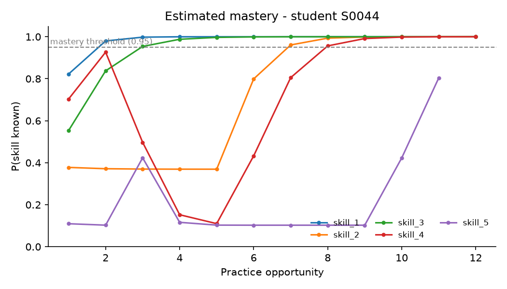
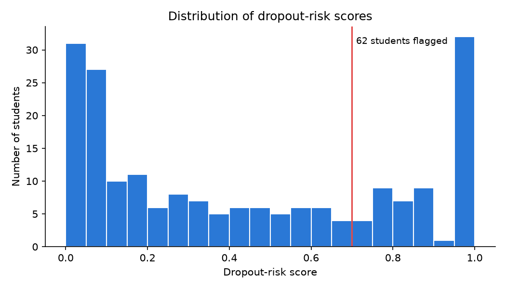

# learner-analytics

[](https://github.com/borzki/learner-analytics/actions/workflows/ci.yml)

[](LICENSE)

Knowledge tracing and dropout-risk analytics for online-course activity logs.

This tool is a small, self-contained part of the master's research project
*"Development of Models and Methods of Personalized Learning in an Online University
Using Artificial Intelligence"*. It turns a pseudonymised log of quiz answers (as exported
from an LMS such as Moodle) into:

- **mastery estimates** per student and skill, using Bayesian Knowledge Tracing (BKT);
- **dropout-risk scores** from engagement features, with an explainable formula;
- **evaluation metrics** — AUC of next-answer prediction, AUC of the risk score and the
  **fairness gap** between student groups;
- **plots** and CSV/JSON outputs ready for a report or dashboard.

A built-in simulator produces realistic synthetic logs with a known ground truth, so the
whole pipeline can be run, tested and reproduced without any real student data.

## Quick start

```bash
git clone https://github.com/borzki/learner-analytics.git
cd learner-analytics
pip install .

learner-analytics simulate --students 200 --seed 0 --out data
learner-analytics analyze data/logs.csv --truth data/students.csv --out results
```

`results/` then contains `mastery.csv`, `risk.csv`, `summary.json`, `mastery.png` and
`risk.png`. With seed 0 the summary reports a next-answer AUC of **0.84**, a dropout-risk
AUC of **0.88** and a fairness gap of **0.03** between urban and rural students.

| Mastery trajectories of one student | Distribution of dropout-risk scores |
|---|---|
|  |  |

## Input format

One row per answered question, already pseudonymised:

| column | type | example |
|---|---|---|
| `student_id` | text | `S0042` |
| `timestamp` | date-time | `2026-09-03 08:37:50` |
| `skill` | text | `skill_2` |
| `correct` | 0 / 1 | `1` |
| `group` | text (fairness checks only) | `rural` |

`learner_analytics.data.validate_logs` checks the schema and gives a clear error message
if a column is missing or a value is invalid.

## Command-line usage

```text
learner-analytics simulate [--students N] [--skills K] [--attempts A]
                           [--dropout-share P] [--seed S] [--out DIR]
learner-analytics analyze LOGS.csv [--truth STUDENTS.csv] [--skill NAME ...]
                          [--threshold T] [--out DIR]
learner-analytics --version
```

## Python API

```python
from learner_analytics import simulate_logs, dropout_risk, engagement_features
from learner_analytics.bkt import fit_skills, mastery_table

logs, truth = simulate_logs(seed=1)
models = fit_skills(logs)                 # one BKT model per skill
mastery = mastery_table(logs, models)     # students x skills
risk = dropout_risk(engagement_features(logs))
print(models["skill_1"].params, risk.sort_values("risk").tail())
```

## Method in brief

**Bayesian Knowledge Tracing** treats each skill as a hidden "known / not known" state.
Four parameters per skill — initial knowledge, learning rate, guess and slip — are fitted by
maximising the likelihood over a grid of ~1,900 candidates. The forward pass is vectorised
over students *and* candidates with NumPy, so fitting a course takes about a second.

**Dropout risk** is a logistic function of standardised engagement features (days since last
activity, active days, number of attempts, accuracy) with fixed, documented weights. It is a
transparent baseline meant to *flag students for a teacher*, not to make automatic decisions.

## Technology choices

| Need | Choice | Why |
|---|---|---|
| Language | Python 3.10+ | Standard in data science and ML; the thesis models (PyTorch, scikit-learn) use it too |
| Numerics | NumPy | Fast vectorised BKT forward pass without a heavy ML dependency |
| Tables | pandas | Natural fit for log data: grouping by student and skill, CSV input/output |
| Plots | Matplotlib | De-facto standard for publication figures; works headless in CI |
| Tests | pytest + pytest-cov | Concise tests, fixtures, coverage reporting |
| Style | ruff | One fast tool for linting and formatting |
| Packaging | pyproject.toml + hatchling | Modern standard (PEP 517/621); installs a CLI entry point |
| CI/CD | GitHub Actions | Built into GitHub, free for public repositories, matrix builds |

## Development

```bash
pip install -e ".[dev]"
ruff check . && ruff format --check .
pytest --cov=learner_analytics
```

The test suite has 33 tests and covers 99 % of the code. See [CONTRIBUTING.md](CONTRIBUTING.md).

## Continuous integration and delivery

The pipeline in [`.github/workflows/ci.yml`](.github/workflows/ci.yml) runs on every push and
pull request:

1. **Lint** — `ruff check` and `ruff format --check`.
2. **Test** — pytest with coverage on Ubuntu, Windows and macOS × Python 3.10, 3.11, 3.12
   (9 jobs); the build fails if coverage drops below 90 %.
3. **Demo** — runs `simulate` + `analyze` end to end and uploads the plots and summary as an
   artifact, so every commit produces reproducible results.
4. **Build** — builds the wheel and source distribution.
5. **Release** (CD) — when a tag such as `v0.1.0` is pushed, the package and demo plots are
   attached to a GitHub Release automatically.

## Data protection

The tool works only with pseudonymised identifiers and never needs names or contact details.
Synthetic data are used for all examples and tests; real logs must not be committed to the
repository (`*.csv` is ignored by `.gitignore`).

## Citation

If you use this software, please cite it using the metadata in [CITATION.cff](CITATION.cff).

## License

[MIT](LICENSE)
